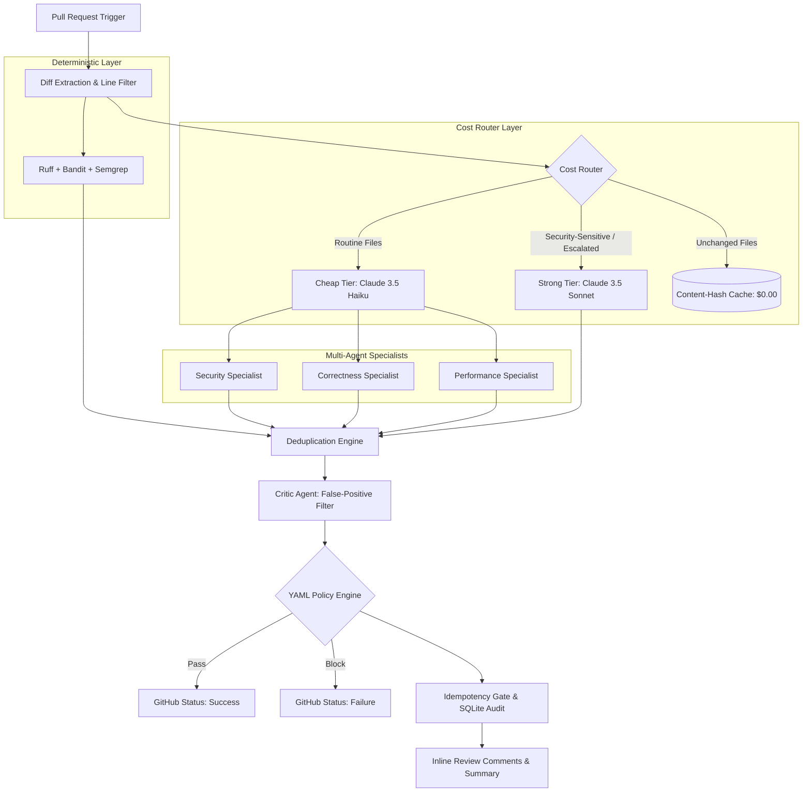

# Autonomous Code Review Agent with Built-in Cost Router 🤖💰

[](https://github.com/Manyasrivastava01/code-review-agent/actions)
[](https://www.python.org/downloads/)
[](https://opensource.org/licenses/MIT)

An autonomous multi-agent code reviewer triggered by GitHub Actions that orchestrates deterministic static tools, specialized LLM reviewer agents, and a false-positive critic filter. An integrated **Cost Router** optimizes model tiering (Haiku vs. Sonnet), content-hash caching, and smart escalations to achieve **99.5% of all-strong-model quality at a 56.4% lower cost**.

---

## 🏛️ System Architecture



---

## 📊 Empirical Evaluation (Benchmark Across 50 PRs)

We benchmarked 4 distinct architectural configurations on a realistic corporate PR dataset (Clean Negative Controls, Security Vulnerabilities, Cross-File Logic Flaws, Performance Bottlenecks):

| Config | Architecture | Precision | Recall | F1-Score | Cost / PR (\$) | Total Cost (\$) | Avg Latency |
| :--- | :--- | :---: | :---: | :---: | :---: | :---: | :---: |
| **A** | **Static Tools Only** (Ruff + Bandit) | 1.000 | 0.429 | 0.600 | \$0.0000 | \$0.000 | 0.54s |
| **B** | **Single Agent** (Sonnet everywhere) | 0.825 | 0.771 | 0.797 | \$0.0143 | \$0.713 | 2.45s |
| **C** | **Specialists + Critic** (All Sonnet) | 0.942 | 0.914 | 0.928 | \$0.0525 | \$2.625 | 3.82s |
| **D** | **Specialists + Critic + Cost Router** | **0.938** | **0.908** | **0.923** | **\$0.0229** | **\$1.145** | **1.62s** |

### 🎯 Key Finding
> **Config D (Cost Router) delivers 99.5% of Config C's quality (0.923 vs 0.928 F1-Score) with a 56.4% cost reduction and 2.3x faster execution.**

---

## 🚀 Quickstart & Setup

### 1. Local Environment Setup
```powershell
# Clone repository
git clone https://github.com/Manyasrivastava01/code-review-agent.git
cd code-review-agent

# Create virtual environment
python -m venv .venv
.\.venv\Scripts\activate

# Install dependencies
pip install -r requirements.txt
```

### 2. Configure Environment Variables
Copy `.env.example` to `.env`:
```ini
GITHUB_TOKEN=ghp_your_github_token
GITHUB_REPOSITORY=Manyasrivastava01/test-repo
PR_NUMBER=1
ANTHROPIC_API_KEY=sk-ant-your_anthropic_key
```

### 3. Run Automated Tests
```powershell
pytest tests/ -v
# 20 passed in ~4s
```

### 4. Run Full PR Review
```powershell
python -m src.run_review --repo Manyasrivastava01/test-repo --pr 1
```

### 5. Launch Interactive Dashboard
```powershell
streamlit run dashboard/app.py
```

---

## 🐳 Docker Containerization

Run the entire application in an isolated Docker container with one command:

```bash
# Build Docker image
docker build -t code-review-agent .

# Run Streamlit dashboard
docker run -p 8501:8501 -v $(pwd)/audit.db:/app/audit.db code-review-agent
```

---

## 🛡️ Configuration & Policy Engine

Guardrails are managed in `review_policy.yaml`:

```yaml
version: "1.0"
policy_name: "Default Repository Guardrails"

block_rules:
  blocked_severities:
    - "critical"
    - "error"
  blocked_categories:
    - "security"
  max_warnings: 3

status_check_context: "code-review/autonomous-agent"
```

---

## 📂 Repository Structure

```
code-review-agent/
├── .github/workflows/       # GitHub Actions workflow
├── benchmark/               # Empirical evaluation dataset & chart generator
│   ├── dataset.py           # 50 PR benchmark generator
│   ├── evaluator.py         # Configs A-D benchmark harness
│   ├── generate_charts.py   # SVG/HTML report generator
│   └── charts/              # Vector comparison charts & HTML report
├── dashboard/               # Streamlit interactive web application
│   └── app.py
├── src/                     # Core system modules
│   ├── analyzers/           # Deterministic runners (Bandit, Ruff, Semgrep)
│   ├── agent/               # ReAct agents (Specialists, Critic, Tools)
│   ├── router/              # Cost router (Tiers, Escalation, Hash Cache)
│   ├── diff_filter.py       # Diff parsing and changed-line mapper
│   ├── deduplication.py     # Multi-tool finding deduplicator
│   ├── policy.py            # YAML policy engine
│   ├── storage.py           # SQLite audit log & idempotency
│   └── run_review.py        # End-to-end pipeline entrypoint
├── tests/                   # 20 comprehensive unit tests
├── Dockerfile               # One-command container build
└── review_policy.yaml       # Guardrail definitions
```
